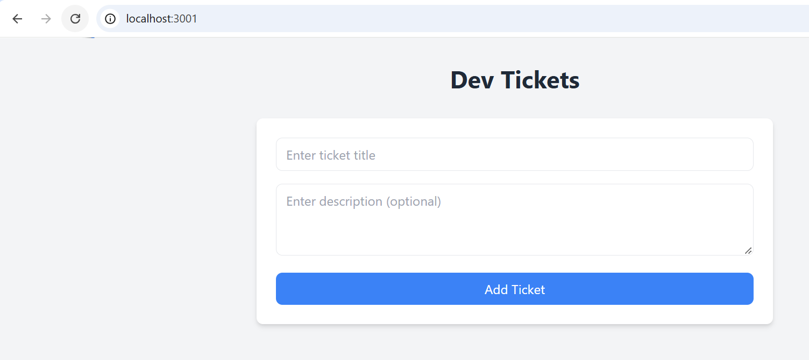
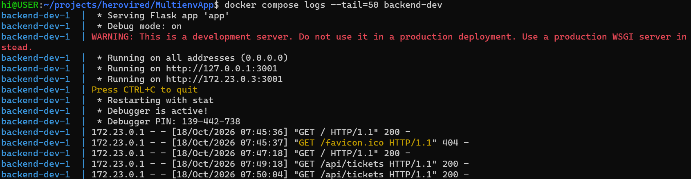
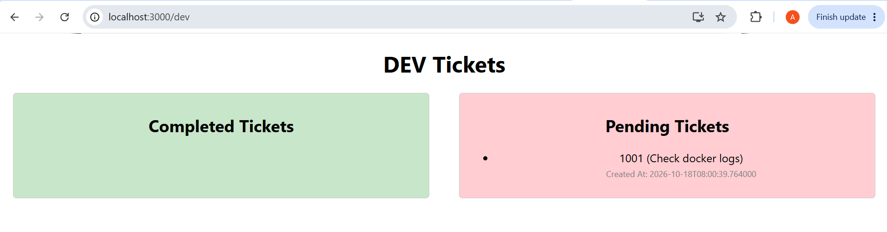
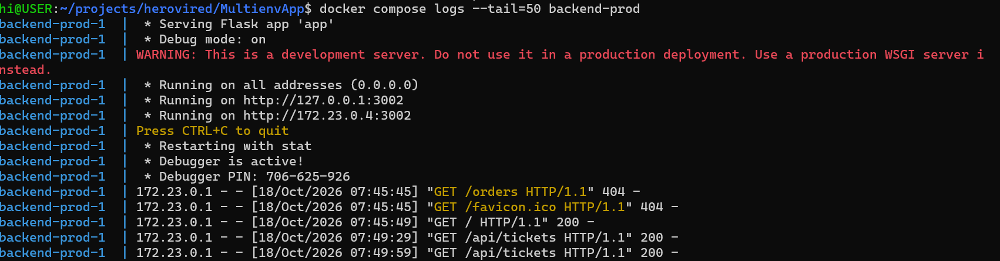
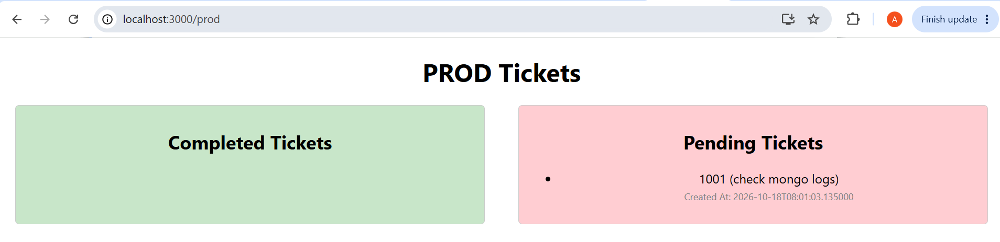
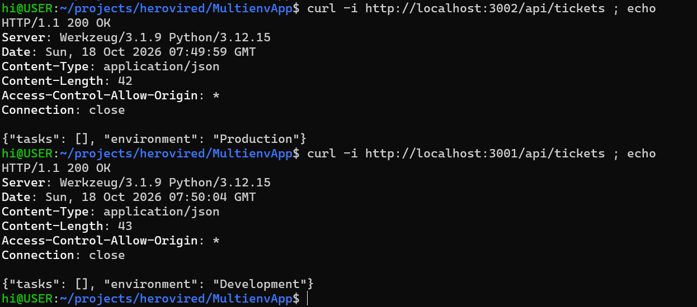
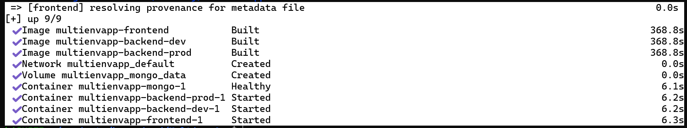
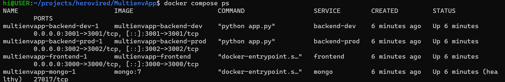
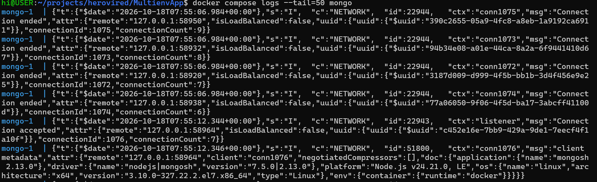
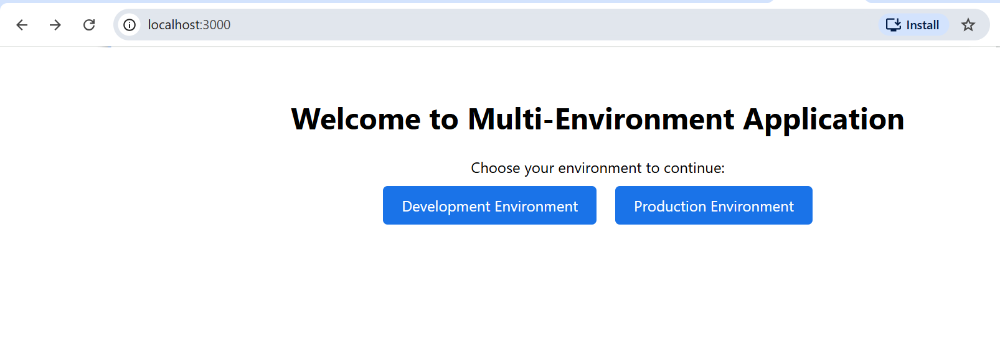

# MultiEnv Ticket Management System using Docker Compose

A full-stack application using Flask for both frontend and backend services, demonstrating environment-specific ticket management.

## Project Structure

```
multienv/
├── docker-compose.yml
├── backend/
│   ├── dev/
│   │   ├── app.py
│   │   ├── requirements.txt
│   │   ├── Dockerfile
│   │   └── .env
│   └── prod/
│       ├── app.py
│       ├── requirements.txt
│       ├── Dockerfile
│       └── .env
└── frontend/
    ├── app.py
    ├── requirements.txt
    ├── Dockerfile
    └── .env
```

Due to time constraint one mongo db container used for both Prod and Dev endpoints.

### Backend Development Deployment






### Backend Production Environment 





### CLI 

```CLI service validation after the deployment
```


```
docker compose up --build -d
```


```
docker ps
```


```
MongoDB deployment logs
```


```
Production Service logs
```


```
Development Service logs
```


```
Application FrontEnd
```

## Accessing the Application

- Frontend: http://localhost:3000/
- Development Environment: http://localhost:3001/dev
- Production Environment: http://localhost:3002/prod


